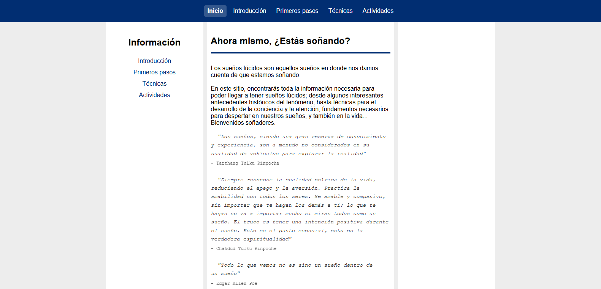
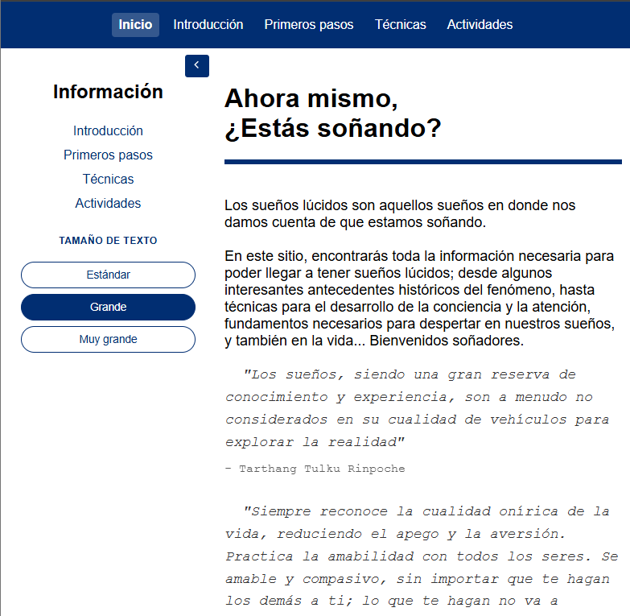
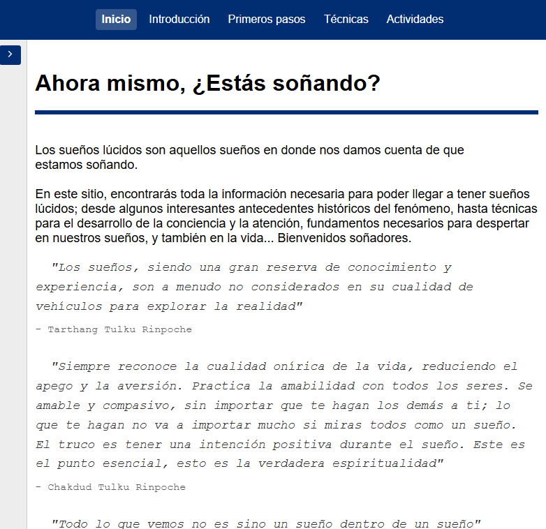

# Sueños Lúcidos - Información sobre Sueños Lúcidos

Sitio web informativo desarrollado con **React + Vite** que ofrece contenido organizado sobre sueños lúcidos, técnicas para inducirlos y actividades relacionadas, mediante una interfaz intuitiva y totalmente responsive.

🔗 **Demo:** https://pagina-estatica-react.netlify.app/

---

## ✨ Características principales

- 🖥️ **Desktop First** – Estrategia de diseño que prioriza la experiencia en escritorio y se adapta de forma responsive a tablets y dispositivos móviles.
- 🧭 **Doble sistema de navegación** – Menú principal fijo combinado con un menú lateral dinámico que cambia según el contenido de cada sección.
- 📚 **Aside colapsable** – Optimizado para tablets, permitiendo ampliar el espacio de lectura sin perder accesibilidad al índice.
- 🔠 **Control de tamaño de fuente** – Opciones de tamaño estándar, grande y muy grande con persistencia mediante `localStorage`.
- 📱 **Diseño responsive** – Interfaz adaptada a móviles, tablets y escritorio.
- ⚡ **Enrutamiento completo** – Navegación fluida mediante React Router DOM.

---

## 📸 Capturas de pantalla

### 🖥️ Vista Desktop



### 📱 Vista Tablet





---

## 🛠️ Stack Tecnológico

| Tecnología       | Uso                           |
| ---------------- | ----------------------------- |
| React 19         | UI y componentes              |
| Vite             | Build tool y desarrollo       |
| React Router DOM | Enrutamiento de la aplicación |
| CSS3             | Estilos y diseño responsive   |
| Netlify          | Despliegue y hosting          |

---

## 🚀 Funcionalidades destacadas

### 📖 Navegación dinámica

```text
Usuario selecciona una sección
        ↓
React Router cambia la ruta
        ↓
Se actualiza el contenido principal
        ↓
El menú lateral muestra el índice correspondiente
        ↓
Navegación fluida entre temas
```

### 🔠 Control de tamaño de fuente

```text
Usuario selecciona un tamaño
        ↓
Se actualiza el estado global
        ↓
La preferencia se guarda en localStorage
        ↓
El sitio mantiene el tamaño elegido
        ↓
Mejor experiencia de lectura
```

---

## 📂 Estructura del Proyecto

```text
/
├── src/
│   ├── components/      # Componentes reutilizables
│   ├── data/            # Datos de navegación
│   ├── hooks/           # Custom Hooks (useFontSize)
│   ├── pages/           # Contenido de las secciones
│   ├── styles/          # Estilos CSS
│   └── App.jsx
├── index.html
├── package.json
└── netlify.toml
```

---

## 📖 Referencias bibliográficas

**El gran libro de HTML5, CSS3 y Javascript**
**Juan Diego Gauchat**
Guía completa sobre las tecnologías fundamentales del desarrollo web moderno.

**Eloquent JavaScript (JavaScript Elocuente)**
**Marijn Haverbeke**
Libro moderno y práctico que cubre desde fundamentos hasta temas avanzados del lenguaje. Disponible gratuitamente en línea, con enfoque en código claro y eficiente.

---

## 📝 Licencia

Proyecto desarrollado con fines educativos y de portafolio.
